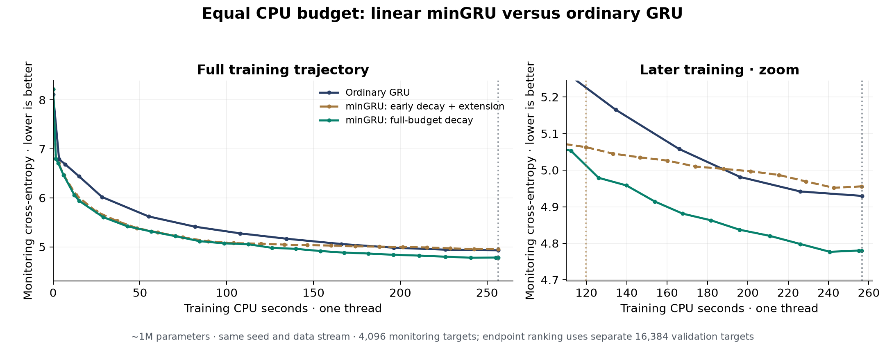

# Equal-CPU GRU comparison

Linear minGRU with a fresh full-budget learning-rate schedule finishes at **4.680991 CE**, 0.183124 nats lower than ordinary GRU at **4.864115**. Both spend approximately **256.56 single-thread training CPU seconds**. The simpler continuation reaches **4.856402**, showing that the schedule materially affects how much benefit the extra updates provide.

This is an independent, single-seed explorer experiment in the contributor's fork, separate from official Super-1 studies. No official test data, GPU allocation or paid resources were used.

## Endpoint results

| Model / schedule | Updates | Target exposures | CPU seconds | Final CE | Perplexity |
|---|---:|---:|---:|---:|---:|
| Ordinary GRU | 2,000 | 1,024,000 | 256.56 | 4.864115 | 129.56 |
| Linear minGRU: 2000 updates | 2,000 | 1,024,000 | 119.85 | 4.988805 | 146.76 |
| Linear minGRU: low-LR extension | 4,489 | 2,298,368 | 256.38 | 4.856402 | 128.56 |
| Linear minGRU: fresh full-budget decay | 4,524 | 2,316,288 | 256.37 | 4.680991 | 107.88 |

All models have approximately 1M parameters: native 995,925, linear 996,320. CE is in nats per 2048-BPE token. All endpoint rows use the same 32 held-out windows /16,384 targets; no best-checkpoint selection. The 2000-step linear row is an equal-token reference, not an equal-time endpoint. Native and that reference are immutable reused results from [the previous study](gru-extended-20261016-v1.md).

Fresh linear sees **2.26×** as many target exposures and changes perplexity by **-16.73%** relative to native. It has lower CE on **32/32** final windows; continuation has lower CE on **18/32**. Those are descriptive comparisons, not confidence intervals or independent replications. The budgets are within0.193s and0.182s of the native budget, respectively, and both stop below it.

## Loss versus time



The graph shows the separate 8-window monitoring set, not the endpoint-ranking set. Joined markers interpolate visually between recorded observations. At119.85s, the earlier linear checkpoint has monitor CE5.062891; linearly interpolating native's saved800/1000-step observations gives5.225367. That interpolated value is not a directly evaluated checkpoint. Final monitoring and final endpoint CE can rank a near tie differently; the full 32-window endpoint is the declared ranking metric.

## What ran

1. **Budget extension.** Load the exact linear step 2000 model, AdamW moments and Torch RNG. Continue the same predeclared random-window stream at its terminal LR 0.0002. Count the original119.852745s in the total budget. Freeze this procedure before continuation.
2. **Fresh full-budget schedule.** Initialize the same model at seed 101602 from scratch. Keep AdamW, parameter count, objective, input order and 25-update warmup unchanged. Spread cosine decay from0.002 to0.0002 across measured CPU time remaining after warmup. Freeze this additional arm before its training; the continuation had not completed when the fresh arm was registered.
3. **Native control.** Reuse the previous fresh seed 101602 run:2000 updates, warmup 25 then step-based cosine over its full 2000 updates. Its measured 256.559083s defines the time target. Fresh linear's clock-based cosine is approximately the same full-budget shape, not an identical update-indexed schedule.

The timer includes batch construction, model forward/backward, clipping, AdamW and constraints. It excludes validation, checkpoint writes, startup and plotting. It measures training CPU time, not theoretical FLOPs or end-to-end speedrun time. Workers use one CPU thread and FP32; historical native and new runs have the same software/host but were not simultaneous, so load, clock and cache effects remain possible. Stop decisions depend on time, never validation loss. Reproduction will take a different number of updates if host speed changes.

The model is unchanged: input-only sigmoid gates and signed linear candidates permit an affine scan in the fast cell; slow segment/document GRUs still provide feedback every 32 tokens / every 8 segments. Scans therefore cover 32-token chunks. The previous final-weight benchmark found no CPU speed gain from linear minGRU's scan versus its own sequential implementation. Its measured advantage over ordinary GRU mainly reflects the cheaper cell; a fused GPU scan and longer parallel chunks remain untested.

## nanoGPT implications

The earlier common-recipe 400-update CPU pilot used the same 1M scale and seed 101601. Linear minGRU: CE5.778749 in22.96s; nanoGPT: CE6.073029 in41.33s. That is **1.80×** training throughput in this small harness, with better endpoint loss. These short results are context, not a new equal-time nanoGPT result or a tuned-best-recipe comparison. Their source receipts are included under `references/`.

The [public modded-nanoGPT speedrun](https://github.com/KellerJordan/modded-nanogpt) defines a FineWeb validation target on 8 H100 GPUs (README checked 2026-10-16). Our 1M CPU/FineWeb-Edu/2048-BPE results do not establish performance against that target. The practical next speed experiment is matched time-to-target-loss with the same data, tokenizer, hardware and timing boundaries, followed by GPU kernel work if resources are authorized. Ordinary GRU remains the stronger equal-token reference; linear minGRU is a promising time-budget candidate under this recipe.

## Reproduce and inspect

Keep this folder beside `gru-extended-20261016-v1`; its model/vendor files are hash-bound in the frozen protocols. Obtain the contributor-held `gru_extended_checkpoints_20261016.zip` for exact original checkpoints and train/validation arrays (SHA256 `c90bb924b3b69e49bf217582776e7add78292d8c72e8a2fa5e82bd28a6db80a6`). The tokenizer and source data recipe are in the parent study. No data arrays or checkpoints are embedded in Git.

The new `gru_equal_cpu_checkpoints_20261016.zip` preserves both final model/optimizer/RNG states; see [PRESERVATION.json](../results/gru-equal-cpu-20261016-v1/PRESERVATION.json) for its hash. Place its checkpoint files at the specified relative paths. The saved final windows replay within1e-6; parallel/sequential logits and all parameter gradients pass the parent tolerances. Protocol, input/source hashes, offset-prefix continuity, complete traces, learning-rate schedule and actual time budgets are checked. Native replay is inherited from the unchanged parent study.

```bash
python auto-research/results/gru-equal-cpu-20261016-v1/analyze.py --data-dir /path/to/exact/data
python auto-research/results/gru-equal-cpu-20261016-v1/report.py
```

To rerun training, use a separate copy/output directory and remove only that copy's `execution/` and `fresh_execution/` artifacts. Keep the frozen protocols and code. Run `run.py --data-dir ... --cpu 0` for continuation and `fresh.py --data-dir ... --cpu 1` for the fresh arm. Do not rerun preparation on this completed study or overwrite its evidence. Hardware-time scheduling prevents bit-identical fresh-run reproduction from just the seed; the exact observed update/LR trace is preserved in `curves.json.gz`, and checkpoint evaluation is deterministic here.

The parent protocol's inherited prose mistakenly says the ranking uses step 400; its runner, traces and checkpoints used 2000. This report uses the actual2000-step control and leaves the historical evidence unchanged.

Raw evidence: [summary](../results/gru-equal-cpu-20261016-v1/SUMMARY.json), [continuation protocol](../results/gru-equal-cpu-20261016-v1/PROTOCOL.json), [fresh protocol](../results/gru-equal-cpu-20261016-v1/FRESH_PROTOCOL.json), [checks](../results/gru-equal-cpu-20261016-v1/CHECKS.json). One seed, small models, repeatedly reused validation and short reset 512 episodes limit broader scaling or long-context conclusions.
