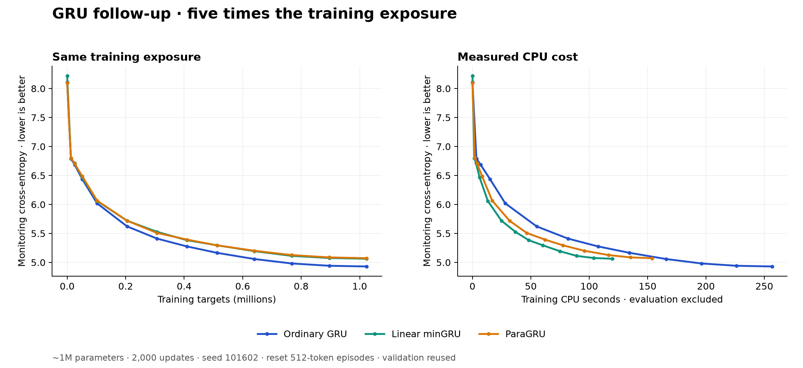

# Experiment report: gru-extended-20261016-v1

Status: **completed exploratory comparison**, not confirmed architecture superiority.

Approval: user request on 2026-10-16 at 15:02 America/Denver to continue linear minGRU/ParaGRU experiments and push code/results to their fork. This independent courtesy study is separate from upstream's official research program. The earlier hosted-workspace execution exception remains in force; no paid resources were provisioned.

Protocol SHA256: `7b4ccea2b278a45faf50c6fb14ee5b4a1f047236d9ede00ac03963eb4f750cdb`. [Frozen protocol](../results/gru-extended-20261016-v1/PROTOCOL.json), [scientific template binding](../results/gru-extended-20261016-v1/SCIENTIFIC_PROTOCOL.json), [registration](../results/gru-extended-20261016-v1/REGISTRATION.json), [source hashes](../results/gru-extended-20261016-v1/SOURCE_MANIFEST.json).

## Question and controls

Does linear minGRU or ParaGRU remain close to native GRU after fivefold training exposure while using less CPU? The competing explanation is that the small earlier gaps masked a larger advantage from dense hidden-to-hidden mixing as learning proceeds. Native GRU is the fresh control. All three retain the same learned slow hierarchy, tied output embedding and 32-token/8-segment clocks, with widths 147/native, 160/minGRU, 153/ParaGRU to match approximately 1M parameters.

Predeclared exploratory rule: final CE no more than 0.03 nats worse than native **and** at least 1.25× lower training CPU time, with complete budgets and numerical checks. This threshold identifies a candidate for another small experiment; it is not a statistical confirmation or promotion gate.

## What actually ran

Three fresh runs, seed 101602, **2,000 updates and 1,024,000 target exposures per arm**. Batch 1, context 512, zero state at each episode; no carry across random windows. EOS remains a token, with no additional within-window reset. All use the same ordered windows, optimizer and final-checkpoint selection. AdamW peak 0.002, warmup 25, cosine over 2,000 updates to 0.0002, clip 1, FP32. No teacher, no distillation, no auxiliary objective. Recurrent diagonal vectors are excluded from decay and projected to L2 norm<=0.5 in ParaGRU.

The initialization seed and cosine horizon differ from the earlier 400-update screen. The first 400 data windows are the same; 1,600 more follow from the same RNG stream. Consequently, cross-study gains are not a controlled estimate of changing only training duration. No arm received extra tuning.

The preserved FineWeb-Edu sample and train-only 2,048-token byte-BPE tokenizer are unchanged and hash-checked. Exact train/validation/tokenizer hashes, source revision and split rules are in [data metadata](../results/gru-extended-20261016-v1/data_metadata/) and [offsets](../results/gru-extended-20261016-v1/OFFSETS.json). Monitoring uses 4,096 targets; final ranking uses 16,384 targets in a distinct validation region. Both regions were already used in earlier research. No official test was opened.

Execution used the existing CPU workspace, three concurrent workers with one pinned CPU thread each, PyTorch 2.14.1+cpu and NumPy 2.5.4. Aggregate measured training CPU time was **530.19seconds**. All workers finished normally within 900 CPU-second / 1,800 wall-second per-arm caps. Setup, evaluation, analysis and serialization are excluded from training-time columns. All checkpoints include model, optimizer, RNG and full training metrics. [Checkpoint hashes](../results/gru-extended-20261016-v1/CHECKPOINT_MANIFEST.json), [terminal receipt](../results/gru-extended-20261016-v1/TERMINAL.json).

## Results

Final update 2,000, CE in nats per BPE token; lower is better. PPL is exp(CE) for this tokenizer and cannot be compared to unrelated word-level benchmarks.

| Model | Parameters | CE ↓ | PPL ↓ | CE gap vs native | Training CPU seconds ↓ | Native/model CPU ratio |
|---|---:|---:|---:|---:|---:|---:|
| Ordinary GRU | 995,925 | 4.864115 | 129.56 | +0.0000 | 256.56 | 1.00× |
| Linear minGRU | 996,320 | 4.988805 | 146.76 | +0.1247 | 119.85 | 2.14× |
| ParaGRU | 995,724 | 4.995581 | 147.76 | +0.1315 | 153.78 | 1.67× |

Curves show monitoring windows, so their endpoints differ from the final-ranking table. This single-seed comparison has no inferential error bars; paired window counts in [SUMMARY.json](../results/gru-extended-20261016-v1/SUMMARY.json) are descriptive, not seed replication.

Historical context only:

| Model | Earlier400-update CE, seed101601 | Current2,000-update CE, seed 101602 |
|---|---:|---:|
| Ordinary GRU | 5.7689 | 4.8641 |
| Linear minGRU | 5.7787 | 4.9888 |
| ParaGRU | 5.7947 | 4.9956 |

The previous rotating-bank/curve score 5.7008 is from the shorter budget and is **not** a control for this ranking. It was not retrained here. Positive-candidate minGRU was omitted after its preceding poor result. Historical summary/protocol/checks are retained under [prior_screen](../results/gru-extended-20261016-v1/prior_screen/), with no claim that its checkpoints were retrained or re-evaluated.

## Deployment measurements

One-thread CPU benchmarks ran after all training workers exited, with two warmups and five repeats at the final weights. Full-model forward+cross-entropy+backward at 512 tokens is reported below; it excludes optimizer updates. New-cell sequential/parallel paths share all projections and readout, so their pair measures recurrence execution including its backward implementation. Native already uses batched `nn.GRU` and readout; its dense recurrence remains sequential.

| Model | Batched/scan median ms ↓ | Same-cell sequential median ms | Scan speedup |
|---|---:|---:|---:|
| Ordinary GRU | 100.01 | — | N/A |
| Linear minGRU | 48.05 | 45.29 | 0.94× |
| ParaGRU | 71.67 | 147.69 | 2.06× |

[Raw timings](../results/gru-extended-20261016-v1/TIMING.json) also include no-grad forward, 128 stateful one-token calls, all samples and empirical p95. Five repeats are an exploratory latency sample, not a production tail estimate. Streaming uses supplied known tokens and computes all logits; sampling/tokenization is excluded.

| Model | FP32 parameter bytes | Persistent state backing bytes | Peak training process RSS, MiB |
|---|---:|---:|---:|
| Ordinary GRU | 3,983,700 | 2,352 | 449.4 |
| Linear minGRU | 3,985,280 | 2,560 | 444.1 |
| ParaGRU | 3,982,896 | 2,448 | 438.3 |

Persistent state excludes two Python counters and object overhead. Training process RSS includes Python/runtime/optimizer/activations and is not an inference-memory estimate. Dedicated deployment peak activation/workspace and allocator-reserved memory were not measured. State bytes must not be presented as total model memory.

Slow-state feedback limits both new scans to 32-token chunks; this is not full-sequence parallel training. The direct affine tree uses O(T log T) work. ParaGRU uses diagonal recurrent matrices, nonlinear gates, Newton iterations and a reverse scan adjoint, and is a changed architecture from dense GRU. No GPU, large-model scaling, quantization, long-context training or retrieval result is established.

## Decision

- **Linear minGRU: DOES_NOT_MEET_EXPLORATORY_RULE**; CE gap +0.1247, CPU speedup 2.14×.
- **ParaGRU: DOES_NOT_MEET_EXPLORATORY_RULE**; CE gap +0.1315, CPU speedup 1.67×.

Ordinary GRU is the comparator, not a newly promoted model. These decisions apply only to the recorded budget/seed/wrapper; different initializations, full published blocks or another schedule remain alternative explanations. The next useful small architecture test is a 4-token causal input mixer for linear minGRU, with the no-mixer version and native GRU as controls at the same parameter budget. This would test whether missing local token interactions explain part of the loss gap. Expected cost is of the same order as this run (roughly 600 aggregate CPU seconds at 2,000 updates), to be remeasured before launch. No further experiment is running or queued.

## Integrity and cleanup

Initial and final sequential/parallel logits and gradients passed declared tolerances. Prefix/split continuation checks cross both slow-memory clocks. Every one of the 32 final windows per arm replayed from the saved checkpoint within 1e-6 CE; maximum observed error was 0. Final gradient relative L2 error was at most 3.57e-07. ParaGRU solver iteration histogram: `{'3': 34176}`; maximum residual 1.79e-07. No fallback, failed training arm or nonfinite result was hidden. [Checks](../results/gru-extended-20261016-v1/CHECKS.json), [preflight](../results/gru-extended-20261016-v1/PREFLIGHT.json).

Code, metrics, figures, logs and hashes are committed under `auto-research/`. Large checkpoints and token arrays are in a companion artifact outside Git; consult [preservation manifest](../results/gru-extended-20261016-v1/PRESERVATION.json). That artifact is retained for the contributor, not exposed as a public dataset download. Anyone replaying the run needs the hash-matching arrays/checkpoints. [Reproduction commands](../results/gru-extended-20261016-v1/README.md), [sources](../results/gru-extended-20261016-v1/SOURCES.md), [cleanup](../results/gru-extended-20261016-v1/CLEANUP.json).

This branch does not modify upstream model files or old evidence. The user requested a push to their fork; no upstream PR or merge was performed by this run.
