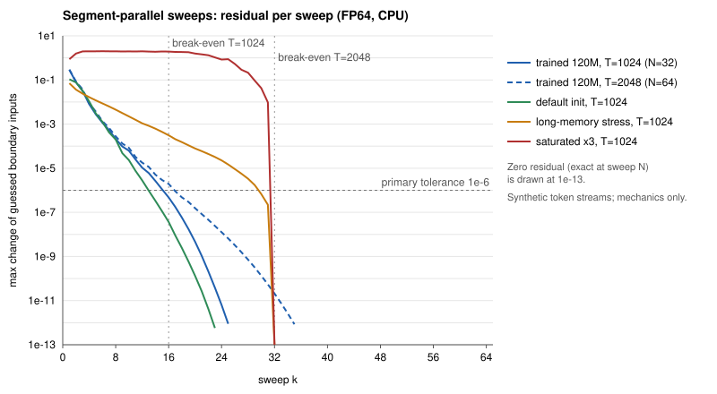

# Experiment report: segment-parallel-sweep-20261101-v1

Status: **completed. Primary hypothesis rejected (falsifier met). No promotion.** A preregistered CPU mechanics canary. The trained 120M hierarchy needed 15–16 sweeps to reach the 1e-6 residual at T = 1024, and 16 was the declared break-even.
Approval reference: the donor's approval of their own compute (VibeCodyH, in the Discovery@Home Claude Code session, 2026-11-01T06:19Z: "Yes, run it"), quoted in `results/segment-parallel-sweep-20261101-v1/APPROVAL.json` along with a separate approval for the post-hoc diagnostic at 07:26Z. Each covered that exact matrix and budget. It is not the maintainer's approval, and it uses none of the maintainer's resources.
Protocol hash and evidence location: `results/segment-parallel-sweep-20261101-v1/PROTOCOL.json` (sha256 `5f46377ba811c8aaeaf84ada787c5c3e20003e7be5b2f3b03226c7db3e8b3149`, frozen 2026-11-01T06:19Z before execution). Post-hoc addendum: `PROTOCOL_ADDENDA.md`. Plan: `results/segment-parallel-sweep-20261101-v1/PLAN.json`. Code: `results/segment-parallel-sweep-20261101-v1/sweep_canary.py`.

Contributed by VibeCodyH through a Discovery@Home donated session. The work was done by an AI agent (Claude Opus 5.5 in Claude Code) and is author-checked only: nobody else has reviewed or reproduced it.

## Question and controls

**E01 question.** `FastHierarchy` (`results/matched-scratch-fineweb-20261017-v1/train.py`) already runs each 32-token segment's fast GRU as one cuDNN call, because the slow states are constant inside a segment. It still loops over segments one at a time. In that run's deployment table, hybrid1 (one hierarchy block plus nine attention blocks) takes 17.49 ms to prefill 1024 tokens at batch 1, against 1.95 ms for nanoGPT, and 26.50 vs 10.09 ms at batch 16. If the nine attention blocks cost 9/12 of nanoGPT's time (an inference, not a measurement), the hierarchy block costs about 16.0 ms at batch 1 and 18.9 ms at batch 16, or about 0.50 and 0.59 ms per segment iteration. Sixteen times the batch costs about 18% more, which suggests the loop is latency-bound. That is an inference stacked on the 9/12 assumption. This run asks whether that loop over segments is forced by the equations or only by the execution order.

**Mechanism (equations unchanged).** Guess the state entering every segment: the fast state, the segment state and the document state that the fast GRU reads. Then repeat a sweep:

1. Run the fast GRU over all N segments at once, as one batch of B·N sequences of 32 tokens.
2. Recompute the slow chains exactly from the new fast means. This needs only two more single recurrences, because `segment_cell` reads only the segment mean and `document_cell` reads only the segment state: Si+1 = segment_cell(meani, Si) over N steps, then Dm = document_cell(S8m, Dm−1) over N/8 steps.
3. Use the new boundary states as the next sweep's guesses.

`combine` runs once at the end. As in the reference, the last token of each segment sees the updated segment and document states.

**Exactness.** Segment 0 always starts from the exact initial state. So after sweep k, segments 0..k−1 match the reference up to rounding (the wavefront), and sweep N reproduces the whole sequence. The fixed point is the reference itself, not an approximation of it. A residual stopping rule still bounds only self-consistency, not the error against the reference, so the run measures that error directly. A safe completion rule: after Kmax sweeps, finish the remaining segments sequentially from the wavefront, which is exact. This rule is described here but was not implemented or tested in this run.

**Favorable fully charged best case (priced before running).** Assume one sweep costs at most two reference segment iterations, about 1.0 ms. That covers two 32-step recurrent calls, one 4-step call, about ten batched launches and one host synchronization for the convergence check. The minimum is K = 2: one sweep plus one sweep that verifies it. At T = 1024 (N = 32), the hierarchy block would drop from about 16 ms to about 2 ms, and hybrid1's batch-1 prefill from 17.5 ms to about 3.5 ms. That is still about 1.8× slower than nanoGPT's 1.95 ms. Break-even is K ≈ 16 at T = 1024 and K ≈ 32 at T = 2048. The recurrent work grows K-fold, so at training batch sizes, where the loop is closer to FLOP-bound, the gain shrinks or reverses. The best case applies to small-batch prefill. These are projections from another run's H100 table, not measurements. They also come from a different model: hybrid1's hierarchy block is width 768, trained from scratch on FineWeb with the GPT-2 vocabulary, while K below is measured on the width-688 Qwen-distilled historical checkpoint. On CPU this run loops `GRUCell` for the slow chains; the single-call GPU form was not implemented.

**Strongest alternative explanation.** A hierarchy whose slow states matter to the fast GRU is exactly one where boundary errors propagate through the slow path. Fast-state forgetting does not damp that path. A trained model may need many sweeps for the same reason the hierarchy might be useful.

**Comparator.** The token-by-token `HierarchicalDistributionStudent.transition` from the recovered byte-exact source (`predictive_models.py`, sha256 `b73a7c07…f73f`), imported unchanged. `FastHierarchy` matched it at FP64 1e-9 in matched-scratch-fineweb-20261017-v1.

**Matching track.** None: this is a mechanics canary, not a quality comparison. Both arms use the same weights and inputs.

**Primary metric.** K(1e-6), the number of sweeps until every guessed boundary input changes by at most 1e-6 (absolute, FP64). It is taken as the maximum over the three primary rows (the trained 120M checkpoint at T = 1024 on three synthetic token streams) and reported with the true maximum hidden-state error at that sweep.

**Declared before execution.** FP64 parity tolerance 1e-9 (as `parity64.py`), FP32 tolerance 1e-5 (as `parity.py`). Falsified if K(1e-6) ≥ 16. A positive control (width 32, must pass) and a failure control (a deliberately wrong last-token rule, which must fail hidden parity) are in the plan. Synthetic rows bracket the trained rows: default initialization (favorable), all cell and combine parameters scaled by 3 (saturated, as `parity64.py`), and the fast update-gate bias raised by 4 (adversarial long memory).

**Pre-run check of the algorithm.** `toy_check.py` is a pure-Python transcription with width 3, segment length 4 and a document update every 2 segments (N = 6). The wavefront held at every sweep. Sweep 6 was exact (residual 0, hidden error 0), and the broken last-token control erred by 0.36 (output in `logs/segment-parallel-sweep-20261101-v1/toy_check.log`). The toy is my own transcription, so it checks the indexing only and is not independent.

## What actually ran

- **Source:** the recovered byte-exact `predictive_models.py` (sha256 `b73a7c07…f73f`, matching `MANIFEST.sha256.json`), imported unchanged. The reference is `HierarchicalDistributionStudent.transition`, token by token. The sweep is `sweep_canary.py` (sha256 `0a90981a93350dcfc26ba29e9e237074ed5e8d71f42c18e9b88367f7f2ba3bac`).
- **Checkpoint:** `pure-hierarchy-final.pt` downloaded from this repository's `recovered-120m-checkpoints-20261015` release. `results/recovered-20261015/CHECKPOINT_RECOVERY.json` records the asset under `rohanarun/function-weights-research` with the same tag, and the downloaded file's sha256 `beb12f7a9fce10195c639365cc673200e04c97affa9557239b70edd28bd9c66f` matches the hash recorded there. It was loaded with `weights_only=True`, and its `model` state dict loaded strictly into `HierarchicalDistributionStudent(151936, 688, ·, 32, 8)`. The checkpoint's own `result` block names arm `hierarchical_qwen_full_kl`, architecture `hierarchical_distribution`, width 688.
- **Inputs:** synthetic token streams only: uniform ids, a repeated 64-id phrase, and ids drawn from a 512-id alphabet, all from fixed seeds. No corpus, no tokenizer, no official test. No training and no optimizer step.
- **Hardware and runtime:** the donor's x86_64 Linux desktop CPU, one thread (`torch.set_num_threads(1)`, `OMP_NUM_THREADS=1`), Python 3.12.13 (uv-managed venv; the frozen protocol listed the host's 3.12.3), torch 2.8.0+cpu, numpy 2.2.6, in a private venv. The canary ran under bwrap (no network, read-only outside the session folder) inside the donor's resource-limit wrapper.
- **Matrix:** the 14 rows of `PLAN.json`, all completed, 193.88 CPU-seconds in total against a 900 s guard. Per-row CPU time is in `RESULTS.json`.
- **Positive control for stored evidence:** `python3 scripts/verify_evidence.py` printed `PASS: 2895 file hashes; 21 selected checkpoints` (`verify_evidence.txt`).
- **Deviation:** the first attempt stopped at that verifier, before any model code ran, because I had edited `CONTRIBUTORS.md` in the clone while the job waited in the queue (`Changed file: CONTRIBUTORS.md`). I reverted the edit and reran the same pipeline. Both logs are in `logs/segment-parallel-sweep-20261101-v1/`. The edit was re-applied after all execution finished.

## Results

K(tol) is the first sweep whose boundary-input residual is ≤ tol. The hidden error is max |hidden − reference| at that sweep (absolute, over all tokens and batch rows). Every row passed the wavefront check at every sweep (segments 0..k−1 within 1e-9 FP64, or 1e-5 FP32, after sweep k).

| Row | Condition / stream | dtype | T (N) | K(1e-4) | K(1e-6) | K(1e-9) | K(1e-12) | hidden err at K(1e-6) | wavefront | parity at convergence |
|---|---|---|---|---:|---:|---:|---:|---:|---|---|
| `smoke_default_w32` | default / uniform | fp64 | 256 (8) | 7 | 8 | 8 | 8 | 1.9e-16 | pass | pass |
| `failctl_broken_last_token_w32` | default / uniform | fp64 | 256 (8) | 7 | 8 | 8 | 8 | 1.9e-02 | pass | fail |
| `default_w688_s1` | default / uniform | fp64 | 1024 (32) | 9 | 13 | 19 | 23 | 9.9e-08 | pass | pass |
| `default_w688_s2` | default / uniform | fp64 | 1024 (32) | 9 | 13 | 19 | 23 | 1.0e-07 | pass | pass |
| `default_w688_s3` | default / uniform | fp64 | 1024 (32) | 9 | 14 | 19 | 23 | 2.8e-08 | pass | pass |
| `scale3_w688_s1` | scale3 / uniform | fp64 | 1024 (32) | 32 | 32 | 32 | 32 | 3.5e-13 | pass | pass |
| `scale3_w688_s2` | scale3 / uniform | fp64 | 1024 (32) | 32 | 32 | 32 | 32 | 6.4e-13 | pass | pass |
| `scale3_w688_s3` | scale3 / uniform | fp64 | 1024 (32) | 32 | 32 | 32 | 32 | 5.5e-13 | pass | pass |
| `longmem_w688_s1` | longmem / uniform | fp64 | 1024 (32) | 20 | 30 | 32 | 32 | 8.3e-08 | pass | pass |
| `trained_uniform_T1024` | trained / uniform | fp64 | 1024 (32) | 9 | 16 | 22 | 25 | 3.9e-07 | pass | pass |
| `trained_periodic_T1024` | trained / periodic | fp64 | 1024 (32) | 10 | 16 | 22 | 25 | 4.2e-07 | pass | pass |
| `trained_smallalpha_T1024` | trained / small_alphabet | fp64 | 1024 (32) | 9 | 15 | 21 | 25 | 8.9e-07 | pass | pass |
| `trained_uniform_T2048` | trained / uniform | fp64 | 2048 (64) | 10 | 17 | 28 | 35 | 1.3e-06 | pass | pass |
| `trained_uniform_T1024_fp32` | trained / uniform | fp32 | 1024 (32) | 9 | 16 | 32 | 32 | 3.8e-07 | pass | pass |

- **Primary (T = 1024, trained):** K(1e-6) = 16, 16 and 15 on the three streams, so the maximum is 16. That meets the preregistered falsifier (≥ 16). **Rejected.** Under the favorable cost model, 16 sweeps cost about the same as the 32 sequential segment iterations they would replace, so there is no latency gain to project. The verdict sits on the boundary: K = 16, 16 and 15, and on the uniform stream the residual after sweep 15 was about 1.1e-6, just above the tolerance. These are single streams with no uncertainty estimate, so read it as no clear gain rather than a decisive loss. The stricter tolerances point the same way (K(1e-9) = 21–22 of 32).
- **Exactness:** every FP64 row except the failure control (which fails by design) converged to the reference within 1e-9 (trained rows: 4.8e-13 to 6.5e-13 at K(1e-12) = 25). Rows that never converged early were exact at sweep N, as the wavefront guarantees.
- **Controls:** the positive control (width 32) matched to 1.9e-16. The failure control (last token fed pre-update slow states) missed by 1.9e-2, so the verifier catches that defect.
- **Residual is not error:** at K(1e-6) the true hidden error was 3.9e-7 to 8.9e-7 on the primary rows and 1.3e-6 at T = 2048. That is up to about 1.3× the residual tolerance. Residual stopping bounds self-consistency only.
- **Trained versus random:** default initialization needed 13–14 sweeps and the trained checkpoint 15–16. The 4,883 training updates did not make the map more forgiving. A pre-run guess in my session notes (not part of the frozen protocol), based on the trained fast update-gate biases, put K at 4–10. It was wrong: gate biases alone do not predict K.
- **Brackets:** saturated weights (×3) got no help from iteration: K = N = 32 at every tolerance, exact at 32. The long-memory stress (fast update-gate bias +4) needed K(1e-6) = 30.
- **Context length (secondary, T = 2048, N = 64):** K(1e-6) = 17, K(1e-9) = 28 and K(1e-12) = 35, against 16, 22 and 25 at T = 1024. Going from 1e-6 to 1e-12 took 9 more sweeps at T = 1024 and 18 at T = 2048. So K grows with N, but sublinearly at the tolerances measured. Under the same cost model the T = 2048 break-even would be about 32 sweeps, and 17 is below that. **This is a post-hoc reading:** the protocol declared the useful effect at T = 1024 only.
- **FP32 (secondary):** K(1e-6) = 16, the same as FP64. The FP32 residual never reached 1e-9 before the exact sweep 32, where it was zero, so its floor sits above 1e-9. At sweep 32 the error against the FP32 reference was 1.8e-7, within the 1e-5 FP32 tolerance.
- **Worst case:** the wavefront fallback bounds the result, not the cost. N sweeps at about two segment iterations each is roughly twice the reference's latency under the cost model.

### Post-hoc diagnostic: which coupling limits K (addendum A1, exploratory)

These four rows were written into `PROTOCOL_ADDENDA.md` after the primary result and approved separately before they ran. They used 43.99 CPU-seconds, with the same streams and seeds as the matching rows above. Each row pins one coupling to its reference value. The data are in `results/segment-parallel-sweep-20261101-v1/diagnostic/`.

| Model (T = 1024) | Full sweep K(1e-6) | Fast boundaries only (slow states pinned) | Slow states only (fast boundaries pinned) |
|---|---:|---:|---:|
| trained 120M, uniform stream | 16 | 5 | 14 |
| default init, seed 1 | 13 | 2 | 12 |

At K(1e-12), the trained model needed 25, 10 and 23 sweeps and default init 23, 3 and 22. The wavefront held in all four rows, and all four converged to within 7.6e-13 of the reference.

- **Against the declared reading:** iterating only the slow states takes 14 of the full 16 sweeps (12 of 13 at default init), so in these two rows the slow feedback path is the main obstruction. The trained fast-only K of 5 misses the declared "≤ 4" by one sweep, so the fast path contributes too. The trained row's fast-only K is higher than the default-init row's (5 against 2), though the two rows also differ in batch and stream. This is post-hoc evidence from one trained row and one default-init seed.
- **Likely mechanism (an interpretation, not measured):** the segment state is a constant input to all 32 fast steps of the next segment. Its error shifts that segment's whole trajectory and mean, and the mean feeds the next segment state. The fast-state forgetting that helps the fast-only rows does nothing for this path.

## Deployment measurements

Unmeasured. No GPU was used, and CPU timings here are not speed evidence. The latency figures above are projections from matched-scratch-fineweb-20261017-v1's H100 table.

## Decision

- **Predeclared criterion: not met.** The maximum K(1e-6) on the trained primary rows is 16, which meets the falsifier. From a cold start, segment-parallel Jacobi sweeps show no clear gain over the sequential segment loop at T = 1024 under the favorable cost model. The falsifier is met at exactly 16. Nothing is promoted, and `FastHierarchy` remains the execution reference.
- **Main obstruction (post-hoc, two rows):** the slow feedback path. Fast-state memory contributes less.
- **Open, not tested here:**
  1. *Accelerate the boundary iteration.* The iteration converges linearly (about 2 decades in 7 sweeps between 1e-4 and 1e-6 on the trained rows), and the slow boundary vector is small: two width-688 states per segment. Anderson acceleration (Anderson 1965; Walker and Ni 2011) or a quasi-Newton update on that vector costs one small least-squares solve per sweep. Proposed test: rerun `trained_uniform_T1024` with Anderson mixing (history 5) on the boundary vector, keeping the wavefront fallback. It succeeds if K(1e-6) ≤ 8 at the same parity and fails if K(1e-6) > 12. Estimated cost: under 2 CPU-minutes on one thread. It needs fresh approval.
  2. *Longer contexts.* From T = 1024 to 2048, K grew sublinearly (16 → 17 at 1e-6, 25 → 35 at 1e-12). If that trend holds, sweeps would pay off at T ≥ 2048 under the cost model. That calls for a preregistered K measurement at T ∈ {2048, 4096, 8192}.
  3. *Measure the sweep cost on the intended GPU.* The assumption that one sweep costs at most two reference segment iterations is unmeasured. An H100 microbenchmark of `FastHierarchy` against a cuDNN sweep at B ∈ {1, 16}, T ∈ {1024, 2048}, bf16, with synchronized p50/p95, would replace it. That's about one GPU-hour, under an approved GPU budget.
  4. *Real text and the precision deployment needs.* Every K here comes from synthetic streams. Whether bf16 inference could stop at a looser residual (K(1e-4) = 9–10 on the trained rows) is a question for the maintainer, not a result.
- **New authority:** any further execution needs fresh approval of the exact experiment and budget.

## Integrity and cleanup

- **Receipts:** `TERMINAL.json`, `RESULTS.json` (14 rows), `SUMMARY.json`, `diagnostic/DIAGNOSTIC.json` (4 rows), and logs for both attempts and the diagnostic in `logs/segment-parallel-sweep-20261101-v1/`. Nothing was overwritten. The failed first attempt is kept.
- **Hashes:** `PROTOCOL.json`, `PLAN.json` and `sweep_canary.py` were hashed when frozen, before execution (see `TERMINAL.json`). The checkpoint's sha256 was verified before loading. `scripts/verify_evidence.py` passed before execution and again on the packaged tree with the new manifest entries (`logs/segment-parallel-sweep-20261101-v1/verify_evidence_packaged.log`). That log reads 2920 hashes because it was written one manifest step before the final registry wording. The committed tree verifies at 2921. The CPU-second figures were recorded while other work was running on the donor's machine. They describe the budget, not speed. The per-sweep wavefront check compares fast outputs only; hidden-state parity is checked at the saved tolerances.
- **Scope:** official test untouched. No corpus, no training, no optimizer step, no network inside the sandbox.
- **Cloud resources:** not applicable; none were used.
- **Outside Git:** the checkpoint copy (457 MiB) and the venv (796 MiB) stay in the donor's session folder, listed in `CLEANUP.json`. No scheduled jobs or alerts were created.
- **Not checked:** GPU latency, the single-call GPU form of the slow chains, the wavefront fallback rule, the bf16 sweep, gradients and the backward pass (training would need an exact adjoint across segments), real text, other checkpoints, widths and segment lengths, and any context beyond 2048. All of this work is author-checked only.

## Prior art and credit

- `FastHierarchy` and its parity harnesses (matched-scratch-fineweb-20261017-v1, Rohan Arun and project agents) supply the segment-constant observation and the tolerances this run reuses. This run adds the across-segment axis.
- ParaGRU in gru-extended-20261016-v1 (@JRowe47) parallelizes a diagonal-recurrence GRU with Newton iterations, which changes the architecture. This run keeps the dense original.
- Parallel-in-time solvers for nonlinear recurrences: DEER ([Lim et al., ICLR 2024](https://arxiv.org/abs/2309.12252)), quasi-DEER and ELK ([Gonzalez et al., NeurIPS 2024](https://arxiv.org/abs/2407.19115)), the Newton/Picard/Jacobi framework of [Gonzalez et al., 2025](https://arxiv.org/abs/2509.21716), and ParaRNN ([arXiv 2510.21450](https://arxiv.org/abs/2510.21450)). Multiple shooting and parareal (Lions, Maday and Turinici, 2001) do the same for ODEs. The sweep here is a block-Jacobi (multiple-shooting) iteration at segment granularity. What is specific to this run: on the original hierarchy the slow chains collapse to two recurrent calls per sweep, the wavefront gives an exact fallback, and K is measured on the trained historical checkpoint. No novelty is claimed.
