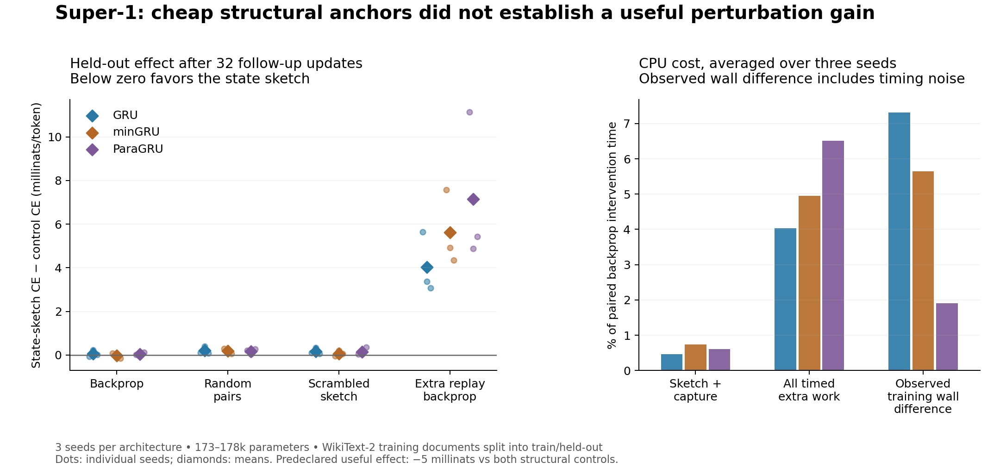

# Super-1: state-anchored perturbation pilot

Publication of an already completed, locally preregistered experiment.
User authorization: “go ahead and push that to the rohan repo, including the perturbation results.”
This central registry entry is retrospective publication, not a new preregistration or rerun.

[Snapshot and reproduction](../results/state-sketch-perturb-20261018-v1/README.md) ·
[Original report](../results/state-sketch-perturb-20261018-v1/snapshot/auto-research/results/state-sketch-perturb-20261018-v1/REPORT.md) ·
[All per-seed results](../results/state-sketch-perturb-20261018-v1/snapshot/auto-research/results/state-sketch-perturb-20261018-v1/ANALYSIS.json) ·
[Publication verification](../results/perturbation-annealing-publication-20261019-v1/VERIFICATION.json)

Run: `state-sketch-perturb-20261018-v1`. Status: **DO_NOT_ADVANCE_THIS_CONFIGURATION**.

Completed 54 paired branches: three seeds × three architectures × six conditions. This is a small CPU screening experiment, not a reproduction of the original full-scale Super-1 result. No settings were retuned after confirmation results.

## Outcome

The frozen advancement gate required at least 0.005 nats/token improvement over both scrambled anchors and random pairs, wins on at least two of three seeds against each, no mean harm versus backprop, sketch/capture overhead at most 1%, and total training wall overhead at most 10%.

| Architecture | Parameters | Backprop CE | State-sketch CE | Δ vs backprop | Δ vs random pairs | Δ vs scrambled | Δ vs replay backprop | Gate |
|---|---:|---:|---:|---:|---:|---:|---:|---|
| GRU | 173,136 | 5.126008 | 5.126063 | +0.000055 | +0.000198 | +0.000162 | +0.004027 | FAIL |
| minGRU | 177,788 | 5.124819 | 5.124801 | -0.000018 | +0.000185 | +0.000067 | +0.005610 | FAIL |
| ParaGRU | 176,050 | 5.160914 | 5.160942 | +0.000028 | +0.000173 | +0.000140 | +0.007147 | FAIL |

**No architecture passed the advancement gate.** This configuration does not justify a larger perturbation run. The passive fingerprint comparison and the downstream optimization test answer different questions: accurately measuring structural similarity is insufficient evidence that the proposed step improves learning.

CE is reserved document-held-out cross-entropy in nats/token after 96 intervention updates and 32 ordinary-backprop follow-up updates. Negative deltas favor the state sketch. Architecture comparisons are not the primary test: widths and parameter counts differ slightly. The primary comparisons are paired within each architecture and seed.

All six conditions, mean final CE:

| Condition | GRU | minGRU | ParaGRU |
|---|---:|---:|---:|
| Backprop | 5.126008 | 5.124819 | 5.160914 |
| IID noise | 5.125959 | 5.124811 | 5.160917 |
| Random pairs | 5.125865 | 5.124616 | 5.160768 |
| State sketch | 5.126063 | 5.124801 | 5.160942 |
| Scrambled sketch | 5.125901 | 5.124734 | 5.160801 |
| Extra replay backprop | 5.122036 | 5.119191 | 5.153795 |

## What was included from Rohan's repo

Pinned upstream: [rohanarun/Super-1@492a87a5e263e806b0a2581c57259e81f1a000e6](https://github.com/rohanarun/Super-1/tree/492a87a5e263e806b0a2581c57259e81f1a000e6). Source files were copied byte-for-byte and checked against Git blob hashes in `UPSTREAM_PROVENANCE.json`.

- Ordinary hierarchical GRU, using the merged batched `nn.GRU` fast path; historical tokenwise equivalence checked.
- Linear minGRU with its parallel affine scan fast layer.
- ParaGRU with the diagonal Newton solve/custom backward and upstream constraints.
- The original segment/document GRU hierarchy, tied embedding/output, final normalization, and two-layer readout.
- The merged AdamW parameter grouping, betas (0.9, 0.95), weight decay 0.1, and clipping. Peak LR was 0.002 with a declared short-run cosine schedule.
- The repository's existing FineWeb-Edu BPE tokenizer with 2,048 vocabulary entries.

These are the repository's fast-cell adaptations within the Super-1 slow hierarchy, not standalone reproductions of the full minGRU or ParaRNN language models. The pilot uses the merged reset-window training style. It does not include continuous learning, persistent full-document state, the historical 120M model, unrelated function-weight Transformer branches, teacher distillation, or Rohan's separately recovered historical W560 perturbation implementation. It tests the requested perturbation idea on the merged recurrent variants.

## Mechanism and controls

A consistent hidden-unit permutation is an exact reparameterization: it preserves the function. The experiment instead takes a small function-changing step along a coupled secant `P(theta) − theta`. Related units are proposed from cached activation relationships; success is never assumed from symmetry alone.

Five coordinate groups cover the tied residual/embedding coordinates, fast state, segment state, document state, and readout intermediate units. Every connected weight, gate row, bias, recurrent column, and normalization parameter is transformed consistently. Two disjoint swaps are proposed per group. Activations include embedding, recurrent states, and readout activations; individual gate activations are not fingerprinted.

The main treatment is CountSketch-64 over the observation axis, supplemented with bounded mean/variance/autocorrelation features. For observation-by-unit matrix X, observation sketch S, and hidden-coordinate permutation P, S(XP) = (SX)P. Renaming units therefore renames the descriptor columns; it does not invent a new geometry from their arbitrary indices. This is the structural anchor being tested.

Descriptors are taken from four recent training windows, refreshed at intervention steps 32 and 96, and reused at step 64. These are cached activations from adjacent optimizer states, not a new full-model evaluation. Four random sorted projections build bounded pair shortlists; no full permutation group or all-pairs assignment is enumerated.

At each event, two directions are tried with both signs, plus the unchanged parent. Each candidate has nominal global parameter L2 radius 0.003 relative to the current weights; ParaGRU constraints can adjust the actual final displacement. The best candidate is retained only if it improves CE on two sequences from the already-seen current training batch. Optimizer moments are retained because this is a parameter perturbation, not a coordinate relabeling. Four candidates are evaluated per event, three events per branch.

| Condition | Purpose |
|---|---|
| Backprop | Identical nominal training schedule, no intervention |
| IID noise | Same relative parameter norm and candidate evaluation budget |
| Random pairs | Coupled permutation secants with random unit pairs |
| State sketch | Current activation relationships choose nearby unit pairs |
| Scrambled sketch | Same sketch algorithm with descriptors reassigned to different units |
| Extra replay backprop | Reuses the same already-seen batch, spending approximately the guided event's wall budget on gradient updates |

The replay control can overshoot by one replay optimizer step. Every realized replay count, overshoot, wall/CPU duration, and example exposure is recorded. This is approximate equal-time comparison on this CPU, not exact equal FLOPs or a GPU speed claim. 'No new tokens' means reusing examples: perturbation scoring still consumes forward-pass compute (15,360 target exposures per intervention branch).

## Cheap metric benchmark

Passive probes measured seven fingerprints on each of nine warmed parents. The table averages the nine parents. Build time excludes activation capture and candidate scoring. Exact trace cosine is the diagnostic target; it is not a measure of useful learning.

| Fingerprint | Build ms | Descriptor KiB | Mean selected true cosine | Fast-state true cosine | Mean oracle gap on shortlist |
|---|---:|---:|---:|---:|---:|
| countsketch-32 | 7.05 | 50.6 | 0.726 | 0.539 | 0.034 |
| countsketch-64 | 7.64 | 94.3 | 0.733 | 0.542 | 0.024 |
| hadamard-32 | 12.42 | 50.6 | 0.730 | 0.544 | 0.032 |
| hadamard-64 | 12.25 | 94.3 | 0.743 | 0.552 | 0.016 |
| dsp-5 | 6.40 | 6.8 | 0.334 | 0.011 | 0.411 |
| fft_power-13 | 10.70 | 17.8 | 0.288 | 0.017 | 0.466 |
| exact-0 | 1.40 | 2800.0 | 0.759 | 0.611 | 0.000 |

Each method produces its own bounded candidate set; the oracle gap compares its selected pairs to the best exact pairs within that same set. This is not full nearest-neighbor recall. The stored `shortlist_seconds` diagnostic includes exact-oracle scoring, so it is not used as an online overhead estimate. Exact descriptors are quick to materialize at this small size but retain much more data; the benchmark does not prove sketches are faster at every width.

The FFT comparator uses log power in eight temporal frequency bands plus basic statistics. It discards phase and is not a test of cross-spectral coherence, phase-preserving FFT sketches, or every DSP approach. The DSP comparator uses mean/std, log std, and lag-1/4/16 autocorrelation. Only CountSketch-64 received an optimization intervention arm; passive metric rankings must not be described as downstream training gains for all seven methods.

## Cost and acceptance

| Architecture | Sketch + capture / baseline | All directly timed extra work / baseline | Observed training wall difference | Accepted guided events | Extra replay updates per seed |
|---|---:|---:|---:|---:|---|
| GRU | 0.46% | 4.04% | +7.31% | 9/9 | [6, 6, 6] |
| minGRU | 0.74% | 4.94% | +5.65% | 9/9 | [9, 9, 10] |
| ParaGRU | 0.61% | 6.51% | +1.91% | 9/9 | [12, 11, 12] |

Ratios use the 96-update intervention period and are averaged within paired seeds. All directly timed extra work includes capture, descriptors, pair selection, candidate construction and forward scoring. Observed wall differences additionally reflect runtime variance in ordinary training. Fixed method order and only one timing per branch limit performance claims. The cheap metric and the complete perturbation search are distinct costs.

## Reproducibility and limits

- Completed in 16.13 minutes main wall time, 16.13 CPU minutes, on one CPU thread. Peak process RSS: 424.8 MiB. Runtime: Python 3.12.14, PyTorch 2.8.0+cpu, NumPy 2.3.5.
- Three independent parent seeds (73, 191, 307); 192 common warmup updates, then paired 96-update intervention and 32-update follow-up branches. Batch 4 × context 512. Roughly 173–178k parameters; early training only.
- Only WikiText-2's training text is downloaded from a pinned commit. Exact documents are deduplicated; the first 16 hexadecimal digits of SHA256(document), modulo 100, assign train/monitor/confirmation. This yields train (482 documents; 3,161,532 tokens), monitor (65; 427,844), and confirmation (62; 464,356). Near-duplicate documents are not screened. No official validation or test split is read. Confirmation evaluates 32 fixed document-local windows (16,384 targets), not every held-out token. Sampling selects documents uniformly, so this is a window-sampling metric rather than corpus-token-weighted perplexity.
- Confirmation never selects proposals, radii, dimensions, or checkpoints. Monitor is recorded at the parent only. Three seeds on one small held-out partition do not establish statistical significance or generality; no inferential p-values are reported.
- All eight FP64 preflight cases passed: historical/batched forward, state, gradients and AdamW updates; parallel/sequential equivalence for every variant; whole-network permutation, sketch, proposal, and optimizer equivariance. All 54 final repeated evaluations were exactly identical in-process. A final audit reloaded one saved guided checkpoint per architecture in a fresh process: all three state hashes and held-out evaluations matched exactly. These checks establish numerical consistency for the exercised cases, not a formal proof for all states or tie cases.
- Slow segment/document states have few updates per reset window. Refresh cadence was fixed; cached pair stability between refreshes was not measured. Autocorrelation of concatenated captured windows includes artificial joins. Similarity is diagnostic and does not by itself establish a favorable loss direction.
- A null result here rejects advancement of this exact radius, pairing, cadence and budget. It does not disprove state-conditioned perturbations at another scale or after more pretraining. No radius sweep, phase-preserving FFT intervention, or GPU experiment was run.
- The compact archive preserves source, tokenizer, document hashes, protocol, every branch's outcomes/candidates/loss trace, and final-state hashes. It omits re-downloadable corpus text, installed packages, and tensor checkpoints. Exact checkpoint recovery requires deterministic rerunning and a matching runtime; cross-platform bit identity is not promised.

Protocol SHA256: `95a246b7909c2e37c20187fbec7981f713192059a7a0ef5facc5423e0a459785`. See `ANALYSIS.json` for every paired delta and gate check, `PREFLIGHT.json` for numerical errors, and branch JSON files for all raw measurements.

## Next decision

This configuration failed its frozen advancement gate; the present pilot does not justify scaling it up. The descriptor may be useful as a cheap structural measurement even when its proposed perturbations add no measurable learning benefit. Any later phase-preserving or curvature-sensitive proposal should be registered as a separate experiment with fresh confirmation data, rather than tuned against this reserved result.

## Publication scope

Deployment throughput, prefill/decode latency, full-model GPU behavior and
converged training were not measured. These are bounded CPU optimization pilots.
The numerical checks and saved checkpoint audits are evidence about these runs,
not an independent replication. No new training, official-test access, cloud
resources or scheduled jobs were used for this publication. The original source,
protocol and all outcome records are preserved in the linked snapshot.
