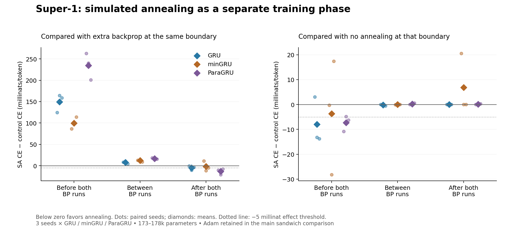

# Super-1: separate-phase simulated annealing

**Practical interpretation:** Do not scale this configuration: no qualifying advantage that improved the model rather than returning an unchanged baseline.

Run `phase-annealing-20261019-v1`. Frozen numerical gate status: **EXPLORATORY_GATE_ONLY**.

All 99 paired outcomes completed: three architectures × three seeds × eleven conditions. Annealing was a standalone, forward-only phase before all BP, between two complete short BP runs, or after both BP runs. No permutation descriptors or structural matching were used.

## Outcome

Primary test: BP A → SA → BP B with Adam state retained, versus spending approximately the same phase wall time on additional BP. The frozen usefulness gate requires at least 0.005 nats/token mean improvement over extra BP, wins in at least two of three seeds, and no mean harm versus the no-SA baseline. Other placements and reset comparisons are exploratory.

| Architecture | Placement | Δ CE vs extra BP | Wins / 3 | Δ CE vs no-SA | Gate |
|---|---|---:|---:|---:|---|
| GRU | pre | +0.149324 | 0 | -0.007937 | FAIL |
| GRU | middle_keep | +0.007764 | 0 | -0.000186 | FAIL |
| GRU | middle_reset | +0.007977 | 0 | -0.000114 | FAIL |
| GRU | post | -0.005086 | 3 | +0.000000 | PASS |
| minGRU | pre | +0.099894 | 0 | -0.003695 | FAIL |
| minGRU | middle_keep | +0.012130 | 0 | -0.000022 | FAIL |
| minGRU | middle_reset | +0.012408 | 0 | -0.000004 | FAIL |
| minGRU | post | -0.001747 | 2 | +0.006841 | FAIL |
| ParaGRU | pre | +0.234534 | 0 | -0.007313 | FAIL |
| ParaGRU | middle_keep | +0.016636 | 0 | +0.000209 | FAIL |
| ParaGRU | middle_reset | +0.016599 | 0 | +0.000346 | FAIL |
| ParaGRU | post | -0.013094 | 3 | +0.000115 | FAIL |

**Relative gate without a model improvement:** GRU / post. These SA arms returned the unchanged baseline in all three seeds. Their apparent advantage comes from extra BP worsening held-out loss. This is not an annealing learning gain and does not justify scaling the SA phase.

Negative deltas favor annealing. Every final score is evaluated on the same fixed 16,384 held-out targets. Comparisons are paired within an architecture and seed; absolute CE across architectures is not the primary test.

The primary sandwich gate did not pass for any architecture. The exploratory numerical passes only returned unchanged baselines; they do not support scaling annealing.

## All conditions

| Condition | GRU mean CE | minGRU mean CE | ParaGRU mean CE |
|---|---:|---:|---:|
| BP A → BP B, Adam retained | 5.373521 | 5.379412 | 5.406389 |
| BP A → reset Adam → BP B | 5.376333 | 5.382944 | 5.409809 |
| BP A → SA → BP B, Adam retained | 5.373335 | 5.379389 | 5.406597 |
| BP A → SA → reset Adam → BP B | 5.376219 | 5.382940 | 5.410155 |
| BP A → extra BP → BP B, Adam retained | 5.365571 | 5.367260 | 5.389961 |
| BP A → extra BP → reset Adam → BP B | 5.368243 | 5.370532 | 5.393556 |
| BP A → greedy search → BP B | 5.373237 | 5.379277 | 5.407419 |
| BP A → BP B → SA | 5.373521 | 5.386253 | 5.406503 |
| BP A → BP B → extra BP | 5.378607 | 5.387999 | 5.419597 |
| SA → BP A → BP B | 5.365584 | 5.375717 | 5.399075 |
| Extra BP → clear Adam → BP A → BP B | 5.216260 | 5.275823 | 5.164542 |

The no-op boundary is a checkpoint handoff, not idle sleep. Its identity was checked by reproducing the exact next Adam update. Every arm has the same scheduled A-to-B learning-rate restart. Only the explicit reset arms discard Adam moments and step counts. Thus a general learning-rate restart cannot by itself explain an SA-versus-matched-control difference.

## Annealing mechanism

Each SA phase uses a fixed batch of four 512-token training windows. The first A batch is used for pre-SA, the last A batch for middle SA, and the last B batch for post-SA. Parent and candidates are evaluated on exactly the same examples with recurrent state reset. The energy is mean training cross-entropy; it has no added weight regularizer.

The phase freezes a Gaussian proposal scale for each parameter tensor at max(entry RMS, 0.01). All eligible tensors receive independent zero-mean noise. Relative standard deviation cools geometrically from 0.03 to 0.003 over 96 proposals. Eight discarded proposals from the unchanged entry model calibrate the initial temperature: median positive loss increase divided by −log(0.7); if none are positive, median absolute change is used. Temperature cools to 1% of its initial value. The Metropolis acceptance rule is min(1, exp(−ΔCE/T)).

The chain can retain uphill moves. The returned endpoint is the lowest-loss accepted chain state, including the original entry. Temperature probes never select an endpoint. Both the final chain loss and returned-best loss are logged so exploration cannot be confused with the eventual selection. The T=0 middle control uses the same probes, proposal scales, schedule, random Gaussian draws and number of trials; it rejects every strictly uphill move.

For ParaGRU, only its constrained recurrent diagonal vectors `fast_cell.A` are held fixed during SA. All other trainable parameters remain eligible. This avoids a projection that would make the Gaussian proposal asymmetric at the constraint boundary. Ordinary BP continues to update and constrain A.

No backward call or optimizer update occurs during SA. Adam state is hashed before and after every phase and must remain exactly unchanged. Reset arms restart Adam only after the middle phase. Pre-extra-BP clears Adam before run A so its comparison with pre-SA concerns the learned starting weights rather than inherited optimizer memory.

## Did the chain actually explore?

| Architecture | Placement | Accepted / 288 trials | Uphill accepted | Returned original / 3 | Mean calibration CE change | Initial temperatures |
|---|---|---:|---:|---:|---:|---|
| GRU | pre | 213 | 70 | 0 | -0.059314 | 0.0345, 0.02363, 0.007479 |
| GRU | middle_keep | 175 | 73 | 2 | -0.000198 | 0.003639, 0.004972, 0.003015 |
| GRU | post | 194 | 85 | 3 | +0.000000 | 0.005952, 0.009608, 0.006588 |
| minGRU | pre | 198 | 75 | 0 | -0.052704 | 0.01602, 0.02887, 0.01657 |
| minGRU | middle_keep | 187 | 89 | 2 | -0.000380 | 0.005781, 0.004257, 0.00641 |
| minGRU | post | 190 | 75 | 2 | -0.003153 | 0.002182, 0.00949, 0.007655 |
| ParaGRU | pre | 201 | 67 | 0 | -0.067129 | 0.02323, 0.003789, 0.0311 |
| ParaGRU | middle_keep | 185 | 75 | 1 | -0.000986 | 0.004016, 0.005284, 0.006552 |
| ParaGRU | post | 193 | 79 | 2 | -0.001045 | 0.007995, 0.008641, 0.004934 |

The returned calibration loss cannot exceed the phase entry loss because the entry is an eligible fallback. That does not guarantee improved held-out loss or better subsequent BP. A returned-original result means this particular chain did not find a better calibration state; it is not evidence that all annealing schemes fail. The terminal chain endpoint followed by BP was not a separate arm: this experiment tests the best-calibration-checkpoint return rule. A relative win over extra BP caused only by extra-BP overfitting, with SA returning the unchanged baseline, must not be presented as an annealing learning gain.

## Optimizer resets and accepting uphill moves

| Architecture | SA − greedy after BP B | Reset − retain without SA | Reset − retain with SA | Immediate middle-SA held-out change |
|---|---:|---:|---:|---:|
| GRU | +0.000098 | +0.002812 | +0.002885 | +0.001981 |
| minGRU | +0.000112 | +0.003532 | +0.003550 | +0.000026 |
| ParaGRU | -0.000821 | +0.003420 | +0.003558 | +0.000888 |

These are descriptive paired differences. The SA/greedy comparison isolates the acceptance policy within the declared proposal family. It is not a replication of the earlier state-sketch perturbation experiment.

## Cost

| Architecture | Placement | SA phase seconds | Phase cost / baseline training | Observed total overhead | SA / extra-BP total wall ratio | Extra BP updates per seed |
|---|---|---:|---:|---:|---:|---|
| GRU | pre | 3.45 | 10.0% | +12.9% | 1.010 | [22, 31, 32] |
| GRU | middle_keep | 2.70 | 7.8% | +8.1% | 0.992 | [23, 23, 22] |
| GRU | post | 3.01 | 8.8% | +8.8% | 0.998 | [30, 23, 21] |
| minGRU | pre | 2.13 | 9.0% | +10.4% | 0.995 | [25, 26, 28] |
| minGRU | middle_keep | 2.83 | 12.0% | +11.6% | 0.999 | [42, 38, 26] |
| minGRU | post | 2.84 | 12.0% | +12.0% | 0.998 | [38, 26, 39] |
| ParaGRU | pre | 4.75 | 16.1% | +13.8% | 0.993 | [43, 47, 52] |
| ParaGRU | middle_keep | 5.33 | 18.1% | +17.5% | 0.993 | [51, 50, 58] |
| ParaGRU | post | 5.13 | 17.4% | +17.4% | 0.998 | [51, 51, 52] |

Each SA phase charges 106 forwards: entry, eight temperature probes, 96 chain proposals, and one returned-state verification. That is 217,088 target exposures on reused training examples. It consumes no new examples at the middle/post boundary, but is not token-free computation.

Extra BP repeatedly uses that identical phase batch until the measured SA wall budget is met. At most one update overshoot is expected and recorded. Extra learning rates are 0.002 before A, 0.0002 after A, and 0.0001 after B. This is approximate equal measured wall time, not exact equal FLOPs. Fixed execution order, shared parent timings, CPU variability and different numbers of repeated example exposures limit stronger efficiency claims. Evaluation and I/O time are excluded from training comparisons but included in the total main-run runtime.

## Protocol and scope

- Architectures: byte-exact ordinary GRU, linear minGRU and ParaGRU fast-cell adaptations within the pinned Super-1 slow hierarchy; widths 48/52/50, approximately 173–178k parameters. Upstream tokenizer and optimizer grouping are retained.
- BP run A: 192 updates, LR warmup 16, peak 0.002, cosine decline to 0.0002. BP run B: 96 updates, warmup 8, peak 0.001, cosine decline to 0.0001. Every update uses batch 4 and context 512. Both are complete short scheduled runs; neither is claimed to reach convergence or represent full-scale pretraining.
- Seeds 419, 563 and 701. Each architecture/seed shares exact initial weights and the same nominal batch sequences across conditions. Middle variants fork from identical run-A weights and moments. Post variants fork from the identical no-SA run-B endpoint.
- Only pinned WikiText-2 TRAIN is used. Training has 482 documents / 3,161,532 tokens. Confirmation has 38 documents / 234,654 tokens, drawn from the previous monitor partition after excluding all 27 documents the old fixed monitor sampler evaluated. Those 38 documents were not trained on or evaluated by the previous pilot. The previous confirmation partition is entirely excluded. Exact document hashes and selection logic are preserved.
- Confirmation uses 32 fixed document-local windows, 16,384 targets, sampled with a new RNG seed. It is a window-sampling CE measure, not corpus-token-weighted perplexity. Exact-document deduplication is applied; near-duplicate screening is not. No official validation or test data were read.
- No confirmation score selects candidates, temperatures, checkpoint endpoints, radii, or training duration. Temperature calibration uses training data only. No settings were changed after the protocol was sealed or after confirmation results were viewed.
- The inference unit is the parent seed, not each of the 99 branches. There are three seeds per architecture. Multiple exploratory comparisons and one small corpus preclude claims of statistical significance or generality.
- This tests one finite Gaussian Metropolis policy, one temperature calibration rule, one radius schedule, one small calibration batch and a best-endpoint return rule. It is not SANTA, gradient-noise training, a theorem of global convergence, exact posterior sampling, or a claim about all simulated annealing.
- Optimizing a repeatedly reused small batch can overfit it. Lower calibration loss is not itself learning progress. There is no sweep over phase duration, temperature, proposal geometry, or late-training saturation.
- Main runtime: 26.92 wall minutes, 26.92 CPU minutes; one CPU thread; peak RSS 430.7 MiB. Python 3.12.14, PyTorch 2.8.0+cpu, NumPy 2.3.5. The cap was 30 minutes.
- Seven preflight checks passed: pinned source hashes, Metropolis formula, synthetic uphill-chain/best-state behavior, forward-only SA and Adam preservation for all three architectures, exact no-op next-update identity, and fresh confirmation separation. Every final in-process repeat evaluation matched exactly. See ARTIFACT_AUDIT.json for checkpoint reload verification.
- The compact deliverable includes source, tokenizer, document hashes, frozen protocol, every outcome/loss trace/candidate decision, timing records and state hashes. It omits downloadable corpus text, token arrays, installed dependencies and tensor checkpoints. Equal-time extra-BP counts vary with machine speed; cross-platform bit identity is not promised.

## Sources and provenance

- [Pinned upstream Super-1](https://github.com/rohanarun/Super-1/tree/492a87a5e263e806b0a2581c57259e81f1a000e6). Source paths and Git blob hashes are in UPSTREAM_PROVENANCE.json.
- [Embedding Simulated Annealing within Stochastic Gradient Descent](https://link.springer.com/chapter/10.1007/978-3-030-85672-4_1), Fischetti and Stringher, 2021: related hybrid-optimization precedent. Our separate-phase Gaussian experiment does not reproduce its gradient-informed neighborhood method.
- [Bridging the Gap between Stochastic Gradient MCMC and Stochastic Optimization](https://proceedings.mlr.press/v51/chen16c.html), Chen et al., 2016: SANTA-related background. SANTA itself was not implemented here.

Protocol SHA256: `53664aa1acffebda396104cf95a52c2c4c0bf467b2b08a74dbde83a07c81f0f9`. See ANALYSIS.json for every paired seed delta and gate result; per-branch JSON files preserve all raw measurements.
